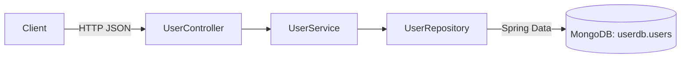

# User Management Microservice

A Spring Boot REST microservice that manages users stored in MongoDB. It exposes CRUD endpoints under `/api/users`, validates incoming payloads with Jakarta Bean Validation, and publishes interactive API documentation through springdoc-openapi (Swagger UI).

## Features

- Create, list, fetch, update and delete users (`/api/users`)
- Request validation on create/update: required name, required and well-formed email, age between 0 and 120
- MongoDB persistence through Spring Data MongoDB (`users` collection)
- OpenAPI 3 documentation and Swagger UI via springdoc-openapi
- Packaged as an executable WAR that can also be deployed to an external servlet container (`ServletInitializer`)
- Unit tests for the service (Mockito) and controller (`@WebMvcTest` + MockMvc)

## Tech stack

| Component | Version |
|-----------|---------|
| Java | 17 (`java.version` in `pom.xml`) |
| Spring Boot | 4.0.6 |
| Spring Web MVC | managed by Spring Boot |
| Spring Data MongoDB | managed by Spring Boot |
| springdoc-openapi-starter-webmvc-ui | 3.0.2 |
| Lombok | managed by Spring Boot |
| JUnit 5, Mockito, MockMvc | managed by Spring Boot |
| Maven Wrapper | Maven 3.9.14 |

## Architecture



## REST API

Base path: `/api/users`

| Method | Path | Description | Request body | Response |
|--------|------|-------------|--------------|----------|
| `POST` | `/api/users` | Create a user | `User` (validated) | Created `User` |
| `GET` | `/api/users` | List all users | - | `User[]` |
| `GET` | `/api/users/{id}` | Get a user by id | - | `User` |
| `PUT` | `/api/users/{id}` | Update name, email and age of a user | `User` (validated) | Updated `User` |
| `DELETE` | `/api/users/{id}` | Delete a user | - | Plain text `User deleted successfully` |

Invalid payloads return `400 Bad Request`. When a user id does not exist, the service throws a `RuntimeException`; there is no custom exception handler yet, so this currently surfaces as a `500` error.

### User model

```json
{
  "id": "string (generated by MongoDB)",
  "name": "string, required",
  "email": "string, required, valid email",
  "age": "integer, 0-120"
}
```

Example:

```bash
curl -X POST http://localhost:8080/api/users \
  -H "Content-Type: application/json" \
  -d '{"name":"Ahmed","email":"ahmed@example.com","age":25}'
```

### API documentation

With the application running (springdoc defaults):

- Swagger UI: `http://localhost:8080/swagger-ui.html`
- OpenAPI JSON: `http://localhost:8080/v3/api-docs`

## Project structure

```
src/
├── main/
│   ├── java/com/smd/user_management/
│   │   ├── UserManagementApplication.java   # Spring Boot entry point
│   │   ├── ServletInitializer.java          # WAR deployment support
│   │   ├── controller/UserController.java   # REST endpoints
│   │   ├── model/User.java                  # MongoDB document + validation rules
│   │   ├── repository/UserRepository.java   # MongoRepository<User, String>
│   │   └── service/                         # UserService + UserServiceImpl
│   └── resources/application.properties
└── test/java/com/smd/user_management/
    ├── UserManagementApplicationTests.java  # context load test (needs MongoDB)
    ├── controller/UserControllerTest.java   # @WebMvcTest
    ├── repository/UserRepositoryTest.java   # @SpringBootTest (needs MongoDB)
    └── service/UserServiceTest.java         # Mockito unit tests
```

## Prerequisites

- JDK 17 or newer
- Maven 3.9+ (or the included Maven Wrapper)
- A MongoDB instance reachable at `localhost:27017` to run the application and the `@SpringBootTest` tests

Start a local MongoDB quickly with Docker:

```bash
docker run -d --name mongo -p 27017:27017 mongo
```

## Configuration

`src/main/resources/application.properties`:

| Key | Default | Purpose |
|-----|---------|---------|
| `spring.application.name` | `user-management` | Application name |
| `server.port` | `8080` | HTTP port |
| `spring.mongodb.host` | `localhost` | MongoDB host |
| `spring.mongodb.port` | `27017` | MongoDB port |
| `spring.mongodb.database` | `userdb` | Database name |
| `spring.mongodb.username` / `password` / `authentication-database` | commented out | Enable for an authenticated MongoDB |
| `server.forward-headers-strategy` | `framework` | Honour `X-Forwarded-*` headers behind a proxy |

Any key can be overridden at runtime, for example `--spring.mongodb.host=mongo` or the `SPRING_MONGODB_HOST` environment variable.

## Build, run and test

```bash
# Build the WAR without running tests
./mvnw -DskipTests package

# Run with Maven
./mvnw spring-boot:run

# Or run the packaged WAR
java -jar target/user-management-0.0.1-SNAPSHOT.war

# Run all tests (the @SpringBootTest classes need MongoDB on localhost:27017)
./mvnw test

# Run only the tests that do not need a database
./mvnw test -Dtest='UserServiceTest,UserControllerTest'
```

On Windows use `mvnw.cmd` instead of `./mvnw`.

## Contributing

See [CONTRIBUTING.md](CONTRIBUTING.md).

## License

Released under the MIT License. See [LICENSE](LICENSE).
